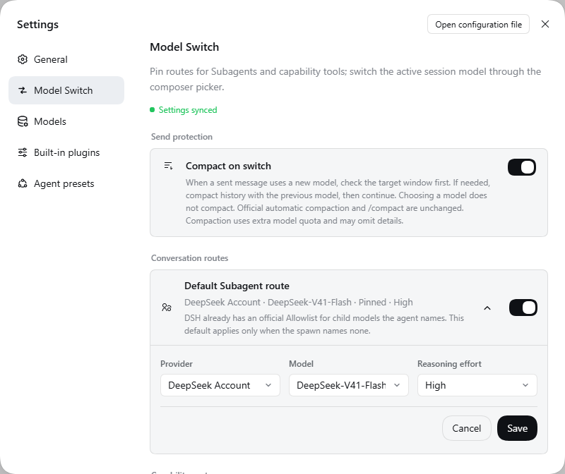

# Model Switch

[English](README.md) | 中文

在 DeepSeek Harness 中为当前会话、Subagent、Web Search、图像生成、Plan 执行和自动会话命名配置明确路由。Model Switch 只使用 DSH 公开服务和 Provider 自有 Adapter；不修改 DSH Core，也不管理 Provider 登录凭证。

<p align="center"></p>

Picker 在切换页面或关闭搜索时保留键盘焦点，不覆盖搜索框的自动聚焦。从摘要页按 Escape 会关闭 Picker，并将焦点还给触发按钮。

## 路由

| 路由 | 行为 |
| --- | --- |
| 会话模型 | 当前对话的 provider/model/effort，只由 Composer Picker 或 Plan Review 修改。部署默认模型（新建会话）归 DSH 自己管理；选择器从不写它。 |
| Subagent | 子代理 spawn 未指定 provider/model/effort 时：使用委派会话自身推导出的路由——其供应商组的子代理对，其次是固定卡片的对；两者都没有则为官方继承（先父请求实时路由，再创建时快照）。显式指定路由的 spawn 永远不会被覆盖；Workflow 显式覆盖始终优先。 |
| Composer Picker | 只修改当前会话，并提交 catalog 中的原始 model id。 |
| Plan Review | 在发送 Plan 审核确认前，先提交执行模型。 |
| Web Search | 保留官方 `web_search`；部署显式启用后，通过 Provider 动态声明的独立搜索适配器路由。 |
| 图像生成 | 提供一个稳定的 `generate_image` 工具，通过选定的 Codex 或 Grok Adapter 路由。 |

无效、不可用或不受支持的路由会明确失败。Model Switch 不会静默换到另一个 provider 或模型。

空闲的空白会话可以选择 External Agent。提交中、等待首个 turn 以及运行期间，从请求开始就锁定所选执行运行时，不等待首 token 或原生绑定：Antigravity 保留其模型和 effort 选择；DSH 保留 LLM provider 选择，但禁用 Agent provider。会话一旦有过用户消息，Composer 和 Plan Review 仍显示 Agent 角色行但将其禁用，除非该会话已经绑定原生运行时。当前会话成功打开 Antigravity 原生会话后，Picker 会在该会话内禁用其他 provider，同时保留 Antigravity 模型与 effort 控件。DSH 全局 Picker 锁仍拥有最高优先级。

## 配置 Subagent 与能力路由

打开 **设置 → Model Switch**。设置页共有六张路由卡片——Subagent、Web 搜索、图像生成、自动审查、压缩、会话命名——外加「供应商配置组」卡片。子代理可以使用委派会话推导出的路由，也可以使用固定的 provider、model 和 effort。

自 0.4.23 起本插件不再配置、也不再保护部署默认模型（原「主模型」卡片）。默认模型归 DSH 自己：Host 会把最后一次会话切换写成默认值（包括经本插件选择器或 TUI 的切换），与原生切换行为一致——新会话从"上次用过的模型"开始。需要固定默认值时，请使用 DSH 自带的 **设置 → 模型** 页面。官方 DSH 在非本机浏览器将 ConfigForms 设为仅内存模式，设置页会明确显示不可用；请在 Host 的 127.0.0.1 页面打开设置。移除主卡片的附带收益：模型切换从此不再依赖设置可写状态（此前选择器要等 Main 表单可写才允许切换）。

切换固定 Subagent 的 provider/model 时，会用目标模型的默认 effort 替换旧模型的 effort；目标模型不支持推理时不传 effort。



官方继承先读取当前父请求，再读取 Host 自身的会话默认模型。推导或固定的路由会在官方 Subagent descriptor 创建前注入，且仅当 spawn 未指定 provider、model 或 effort——显式指定路由的 spawn 永远不会被覆盖，能力不是 `agentOptions` 的 provider（例如一次性进程适配器）也不会被重新解释为可路由的 Agent。DSH 0.1.2-alpha.4 会在该 descriptor 中携带 provider、model 和固定 reasoning effort。

### 保存设置

每一行的保存都是**一次**原子的、带版本围栏的官方 ConfigForm `mutate`：写入被拒绝时要么整行生效、要么什么都不写，不会再留下只写了一半的 provider/model 对。你编辑中的草稿不会被外部快照更新（另一标签页的保存、能力轮询）覆盖；版本冲突会明确报告并提供重新加载路径，而不是悄悄丢掉任何一方；30 秒内始终没有落定的写入会明确报错，而不是让页面卡在「保存中…」。值旁边的 ⚠ 标记现在只有一个含义：该值不在当前 Provider 目录中。

## 自定义模型如何出现在 Picker

Model Switch 不会把自身设置中任意填写的字符串变成模型。Provider 插件必须先把模型发布到 DSH 官方 Model Catalog：

```text
Provider 配置
→ Provider 将模型行发布到 DSH Catalog
→ 当前会话 Model Directory 提供 provider/model 元数据
→ Model Switch 对 Catalog 行分组
→ Picker 提交原始 provider id 和 model id
```

Catalog 提供 provider 名称、model id/name、reasoning efforts 和 default effort。已经保存但不再出现在 Catalog 中的路由，会在 Settings 中显示为 unavailable；Picker 不会假装它仍可路由。

### 变体 id 规则

Model Switch 按 provider，以及剥离以下后缀后的 model id 对 Catalog 行分组：

| Catalog model id | Picker 变体 |
| --- | --- |
| `acme-v1` | 标准模型 |
| `acme-v1-fast` | Fast |
| `acme-v1-128k` | Context 128K |
| `acme-v1-1m` | Context 1M |
| `acme-v1-1m-fast` | Context 1M + Fast |

规则：

- `-fast` 生成 Fast 轴。
- `-<n>k` 和 `-<n>m` 生成 Context 档位；可以与 `-fast` 按任意顺序组合。
- `reasoning.efforts` 生成 Effort 选项；`reasoning.defaultEffort` 是初始值。
- 切换 Fast、Context 或 Thinking 变体时，只有目标 Catalog 行支持当前 effort 才会保留；否则改用目标行的默认 effort，目标没有默认值时不传 effort。
- Catalog 中存在 reasoning 元数据时，该模型行具备 Thinking 能力。
- 无法识别的 id 不会被丢弃，而是作为独立 model family 显示。

组合选择必须由 Provider 发布组合行。只有 `acme-v1-fast` 和 `acme-v1-1m` 不能表示 Fast + 1M；还必须发布 `acme-v1-1m-fast`。Picker 永远不会合成 Provider 没有发布的 model id。

## Plan Review

Plan Review 拥有独立于会话当前路由的执行模型草稿。**确认执行**会先把该模型提交到当前会话，再回答待处理的 Plan 审核。提交被拒绝时，审核保持待处理并允许重试。**拒绝**和**去聊天里说**不会执行 Plan。

**拒绝**会发送提问方给出的选项，并把卡片反馈框里的文字作为答复自身的 `custom` 文本一并提交 —— plan 模式会把它作为"继续规划"的理由回报给模型，所以打回时可以带上要改什么。**去聊天里说**会撤下这张卡、把输入框还给你，用你自己的话说明；它在 Host 提供 `dismiss()` 时用它，在旧代际用 `cancel()`，两者都没有时明确指出这一点。审核一旦落定，**确认执行**与**拒绝**关闭，而**去聊天里说**与"重新加载"始终可达，卡片不会变成死路。失败会保留线上错误码（如 `session/writer-held: …`），而不是只给一句本地化文案。

**设置为目标并执行** 会先把这份 Plan 设为当前会话的 goal、再答复，于是 `dsh-goal-round-driver` 能在退出计划模式后继续推进。它调用已发布的 `remote.goals.create`；若已存在一个未完成的 goal，会先 `clear` 再 `create`，让新 Plan 拿到完整轮次预算，并在替换后提示。目标设置被拒时审核保持待处理、错误带真实错误码（如 `GOAL_AGENT_NOT_LIVE: …`）；部署未挂 goal 服务时该按钮禁用并给出原因，其余三个动作照常可用。objective 取计划全文（trim 后）：goal 域不设长度上限，但它会作为模型可见上下文出现在每一轮续跑里，所以计划很长时每轮都花 token。

卡片正文只显示计划的首行标题与首段摘要，**完整计划**会由官方 ui-plan 自动开到右侧侧边栏（头部的"查看完整计划"可随时再开）。接管的 composer 条目无权渲染官方的 `conversation.plan-review.actions` 槽位（每个子槽只允许一个声明者），因此卡片直接驱动 ui-plan 已注册的 opener——计划文档的地址与参数始终由 ui-plan 自己构造（见 `docs/seam-gap.md`）。


## 自动审查模型（Auto review）

官方 `@deepseek-ai/dsh-experimental-auto-review`（Auto 权限预设的逐调用审查）把审查请求固定在会话自身的路由上。本插件通过 `cordis.patch.yml` 的行替换接管这一行：官方行被禁用，改挂 `dsh-model-switch/auto-review`，它在作用域子上下文里运行**同一份官方 `apply`**，把 `llm.stream` 的 `provider/model` 改写为该会话解析出的审查模型（供应商配置组 → 全局审查卡片 → 会话自身模型）。在 `official.apply(scope)` 之后，本行立即在同一作用域注册 `{ prepend: true }` 的 `tools/pre-execute` 监听器（在 Cordis 瀑布流中排在官方监听器之前），用 `AsyncLocalStorage` 将 `exec.agent.session` 绑定到审查调用链上，因此不同供应商的多个会话并行时互不干扰，会话中途切换供应商也会在下一次审查立即生效。设置页「自动审查模型」默认关闭 = 审查跟随当前会话模型；打开时以目录首位模型作为可再改的固定起点，保存后对下一次审查立即生效。审查未配置官方能力包（`@deepseek-ai/dsh-experimental-auto-review` 未随 profile 启动）时本行不挂载，Auto 预设保持官方的关闭状态；官方行若已在别处注册，本行明确报错而不产生第二个 `registerAuto`。

## 压缩模型（Compaction model）

官方压缩——`/compact` 与 DSH 的自动压缩——默认使用会话当前的目标模型做摘要。「压缩模型」卡片（默认关闭）改为固定摘要路由：打开时以目录首位模型作为可再改的固定起点，保存后对下一次压缩立即生效。两个字段都留空即回到官方默认。保存时若恰有压缩进行中，可能被打断并在下次重试。

每次摘要调用（`options.purpose === 'compaction'`）同样通过 `compactionScope` 按会话实时解析路由：该会话供应商组的压缩对 → 全局压缩卡片对 → 官方行的 `modelPolicies` / 会话目标模型默认。当解析出按会话路由时，子上下文的 `llm` 包装器在调用 `ctx.llm.stream(options)` 前原地更新 `options.provider` 与 `options.model`，从而让官方 `summarizeWithLlm` 返回并持久记录到 `compaction/summary` 的模型对与实际写摘要的模型完全一致。同时，profile 的 `compaction-basic` 行配置里的精确目标 `modelPolicies` 数组仍原样转发：

```yaml
- id: compaction-basic
  name: '@deepseek-ai/dsh-compaction-basic'
  config:
    modelPolicies:
      - provider: deepseek
        model: deepseek-chat
        summarizationProvider: deepseek
        summarizationModel: deepseek-reasoner
```

路由如何到达压缩引擎取决于部署在哪一层组合 agent。Web 面把压缩放进每个 Agent 预设的隔离 `compaction` 组里，而 profile patch 无法寻址 preset `plugins` 列表内部的行——因此本插件整表替换各预设行（与 Web 预设编辑器保存修改用的是同一套 id 定位机制），把该组的官方 `compaction-basic` 换成 `model-switch-compaction`，由它在 `compactionScope` 下挂载**同一份官方 `BasicCompactionEngine`**。进程级组合 agent 的面（如 TUI）则走顶层行替换。两个后果：DSH 发布若改动这些预设，随包副本需要同步（本插件的逐版本核对覆盖这一步）；部署若用 Web 编辑器改预设，会写出自己的整表行、并从那之后自行负责合并。

已知问题（上游侧，见 `docs/seam-gap.md`）：当工作集持续超过官方引擎的压力阈值时，自动压缩可能每步触发，并反复重试摘要过不了官方「摘要必须更小」守卫的小片段——表现为"不停自动压缩"，本插件不控制该行为（已在同一会话做过插件开/关 A/B 对照）。可用的缓解（都在转发行配置上）：`auto: false`（保留 `/compact`）、调高 `thresholdRatio`、减少挂载的工具 schema，或固定一个摘要更精炼的压缩模型。

## 会话命名模型（Session naming model）

DSH 会自动为新会话起名；命名的触发节奏由 profile 的官方命名行决定（首条提示后一次，或每条提示一次）。「会话命名模型」卡片选择这些命名请求使用的模型。**关闭——两个字段都留空——即官方行为：命名跟随会话自身的模型。** 打开时以目录首位模型作为可再改的固定起点。

路由在**每次命名请求时现读**：保存后对下一次起名立即生效、无需重启，且进行中的命名请求不会被保存打断。每次请求按顺序解析路由：该会话供应商组里的命名对，其次卡片的部署级对，其次会话自身的模型。请求经由官方命名实现发出，它会把实际使用的 provider/model 记录到该会话自己的 `session/title-llm-request` 事件里，因此持久记录与真实请求永远一致。本插件替换官方的 `session-title-llm` 行而不分叉命名逻辑（该接缝每个上下文只允许注册一个命名 provider），并镜像该行声明的节奏；profile 没有官方命名行时保持 DSH 的确定性兜底标题。

## 供应商配置组（Provider groups）

「供应商配置组」卡片为每个供应商保存一组路由——压缩、自动审查、会话命名与子代理四条路由一起存；为供应商 X 保存的组，作用于自身供应商就是 X 的会话。组是**推导出来的，而不是写进去的**：切换某个会话的供应商不写任何东西，因此不同供应商上的多个会话并行时再也不会互相覆盖、互相改写对方的辅助路由。

每次请求都从持久状态推导自己的路由：先取该会话的供应商（它的模型选择——刚做出、尚未被请求消费的 pending 选择优先——其次最近一次已记录的请求路由），再取该供应商的组对，再取部署级的平铺对，最后是官方默认（压缩用会话目标模型；自动审查与命名用会话自身模型；子代理用官方继承，且平铺卡片仅在 `fixed` 模式下生效）。因为什么都不写，本浏览器从未打开过的会话、以及来自 TUI 或其他客户端的切换同样生效——没有 watcher，也没有剩余边界；观察不到供应商的会话直接落到部署默认。会话中途切换供应商后，下一次压缩、自动审查、命名或子代理调用都会立即跟随新供应商的配置组。编辑器里首次配置某供应商时，草稿从当前生效的路由种子化；每行的关闭态表示"不固定——先落到卡片、再落到官方默认"；「删除该组」彻底移除该供应商的条目（删掉最后一组时同时清掉存储字段）。

## Model Switch 不会改变什么

- `web_fetch` 及其配置的 provider
- Vision 路由、`read_image` 和普通聊天附件
- Provider 登录、凭证或 Provider 设置卡
- 官方 Agent Presets
- 已有的 Provider 专属图像工具
- 部署默认模型本身（DSH 自己把最后一次会话切换写成默认值，与原生 TUI 切换一致）
- 全局压缩策略、命名节奏（只可配置命名模型）或 DSH Core

## 安装

Model Switch 交付的是预构建代码，安装不需要任何构建授权。从 npm 注册表安装：

```sh
dsh plugin --profile web add --force dsh-model-switch
```

打包好的 tarball 可以在不走注册表的情况下安装同一份构建：

```sh
dsh plugin --profile web add --force ./dsh-model-switch-0.4.17.tgz
```

然后只安装实际使用的 Provider Adapter。此版本已在官方 DeepSeek Harness `0.1.7-rc.2` 上检查，并在 `0.2.0-rc.2` 上验证：

```sh
dsh plugin --profile web add --force \
  https://github.com/NOirBRight/dsh-llm-providers-ui/releases/latest/download/dsh-llm-providers-ui-0.2.14.tgz
dsh plugin --profile web add --force \
  https://github.com/NOirBRight/dsh-llm-codex/releases/latest/download/dsh-llm-codex-0.3.23.tgz
dsh plugin --profile web add --force \
  https://github.com/NOirBRight/dsh-llm-grok/releases/latest/download/dsh-llm-grok-0.3.19.tgz
```

### 搜索供应商统一接入（0.4.7）

搜索列表来自 Host 上已有的 `ModelSwitchAdapterRegistry`，Provider 自声明名称和独立搜索模型；浏览器只收到普通元数据，不收到凭据或可执行函数。注册、卸载会通知订阅者；原地修改模型声明最迟由 20 秒心跳更新。`ProviderDirectory` 继续负责客户端 role/usage，不另造注册表。 已发布 0.2.8 的 `sortCatalogGroups` 只排序硬编码 LLM 路由；Model Switch 自行按实时 `catalogRoutes` 排序，因此 Owner 公布 Agent catalog id 时会跟随已保存的卡片顺序。原生 `catalogId` / `unknown` 账户样式仍需要比已发布 0.2.8 更新的 Owner。模型原生联网不等于独立 `web_search` 适配器。

DeepSeek 薄适配器调用官方公开 `DeepSeekSearchProvider`，复用用户的 `web-search-deepseek` 设置和公开凭据服务；Codex 复用 ChatGPT 登录，Grok 复用已有订阅凭据。缺凭据、配置错误、模型不支持均明确失败，不静默切换。

**注册不等于选中全局路由。** 安装插件不再覆盖 Web 配置。部署时先用 `dsh --profile web --dump-config` 查看完整 Web 配置，只把 `searchProvider` 改为 `model-switch`，其余字段原样保留。注意 id 定位的 patch 会整体替换 `config`，不会深度合并；不能只写 searchProvider，也不能把自定义 fetchProvider 写死成 http。

然后在 Model Switch 设置中选择请求的供应商/模型。全局已选 Model Switch、但没有完整且受支持的搜索配置时，官方选择层返回 `WEB_PROVIDER_CONFIGURED_UNAVAILABLE`，不会回退 DeepSeek。全局未选 Model Switch 时，下拉框不控制官方搜索；未固定全局供应商且有多个可用 provider 时会明确报歧义。卸载前应恢复部署原来的搜索路由。官方 `web_search`、`web_fetch` 均不替换。

本轮分支、测试命令及 3082 live 证据见 [搜索接入审计](docs/search-provider-audit.md)。经授权复用生产 DeepSeek 凭据后，Flash/Pro 的 3082 真实搜索均通过，三家均已有成功证据。Picker 测试夹具及审查发现的元数据恢复问题已修正，保留 v0.4.6 兼容性后全量 172 个测试通过。生产推广仍须先在 lab 安装验收同一组不可变发布产物。

如果 profile 已安装 `dsh-composer-picker`，请先移除它。Model Switch 已经拥有 Composer Picker 和 Plan Review 席位；同时安装会产生重复或竞争 UI。

生产 profile 必须使用已发布的注册表版本或 GitHub tag，不能使用工作区本地依赖。安装或修改路由后重启对应的 DSH profile。

## 兼容性

DSH Host peer 和开发依赖接受 `>=0.1.7-alpha.2`，包括 rc.1 和后续版本。开发锁文件解析到 rc.2。Cordis 接受 `>=4.0.4 <5.0.0`。

已验证版本：`0.1.7-alpha.2`、`0.1.7-rc.1`、`0.1.7-rc.2`、`0.2.0-rc.2`。0.2.0 的声明覆盖三处差异：Host 改名的提问撤下动词（`cancel()` → `dismiss()`）、`session.selectModel` 不 await 的部署默认值写入、以返回值报出的 `ModelDirectory.select` 拒绝；三者均已在 lab（3082/3085）与真实桌面会话中逐一验证。

`package.json#dsh.compatibility.dshReleases` 中的已验证版本是证据，不是允许列表。新增验证声明前要审查公开 API 变化并测试新 Host 版本。

## 开发

需要 Node 22.19+ 和 pnpm。

```sh
pnpm install
pnpm run check
```

`check` 会构建 Host/Client artifacts，运行单元测试和 Cordis/Settings 组合测试，检查提取后的发布包，并验证 bundle 可复现。产品范围见 [PRODUCT.md](PRODUCT.md)，实现约束见 [IMPLEMENTATION_PLAN.md](IMPLEMENTATION_PLAN.md)。

## 正式版安装（Latest）

本版在官方 DeepSeek Harness `0.1.7-rc.2` 与 `0.2.0-rc.2` 上验证了 Main、子代理、Composer、Plan Review 与能力路由；发布包只包含构建后的 Host/Client 产物，不包含兄弟仓库源码或本机路径。

Latest 安装命令（资产文件名必须与当前 latest Release 一致）：

~~~sh
dsh plugin --profile web add --force \
  https://github.com/NOirBRight/dsh-llm-providers-ui/releases/latest/download/dsh-llm-providers-ui-0.2.14.tgz
dsh plugin --profile web add --force \
  https://github.com/NOirBRight/dsh-model-switch/releases/latest/download/dsh-model-switch-0.4.16.tgz
~~~

固定版本安装命令：

~~~sh
dsh plugin --profile web add --force \
  https://github.com/NOirBRight/dsh-llm-providers-ui/releases/download/v0.2.14/dsh-llm-providers-ui-0.2.14.tgz
dsh plugin --profile web add --force \
  https://github.com/NOirBRight/dsh-model-switch/releases/download/v0.4.16/dsh-model-switch-0.4.16.tgz
~~~

更新、卸载与验证：

~~~sh
# 更新到最新 Release
dsh plugin --profile web add --force \
  https://github.com/NOirBRight/dsh-llm-providers-ui/releases/latest/download/dsh-llm-providers-ui-0.2.14.tgz
dsh plugin --profile web add --force \
  https://github.com/NOirBRight/dsh-model-switch/releases/latest/download/dsh-model-switch-0.4.16.tgz
# 验证加载与版本
dsh plugin --profile web list
# 只卸载本插件
dsh plugin --profile web remove dsh-model-switch
~~~

配置入口：Web 使用「设置」中的本插件页面；Host-only 插件使用 profile 的 dsh.profile.bundles 配置。先复制本 README 的最小 YAML/JSON 示例，再填写凭据或后端地址。

回滚：重新安装不可变的 v0.4.15 归档并恢复已记录的 profile；不需要降级 Host。失败时查看 journalctl --user -u dsh-web.service，不要将源码 checkout 链入生产 profile。

Release 与完整性：[v0.4.16](https://github.com/NOirBRight/dsh-model-switch/releases/tag/v0.4.16) · [SHA256](https://github.com/NOirBRight/dsh-model-switch/releases/download/v0.4.16/dsh-model-switch-0.4.16.tgz.sha256)。
